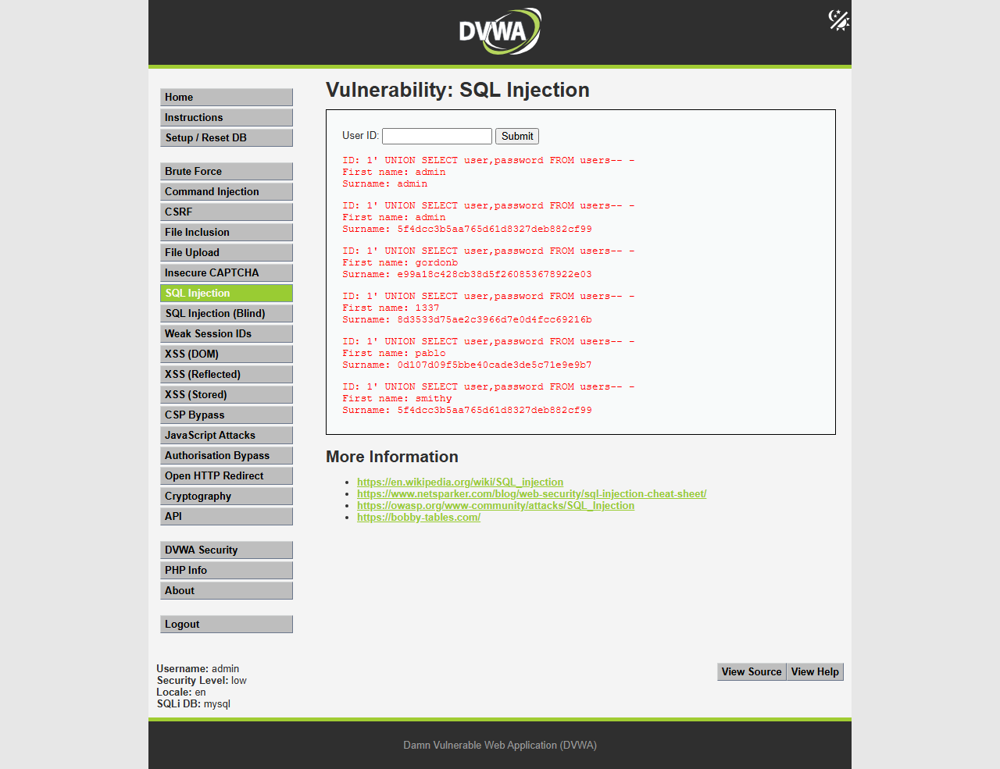
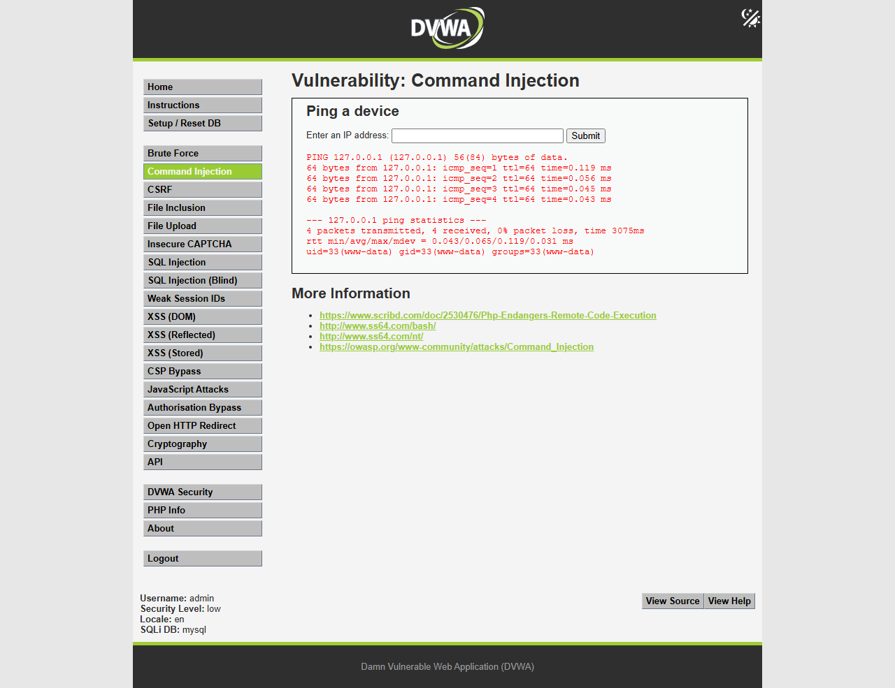
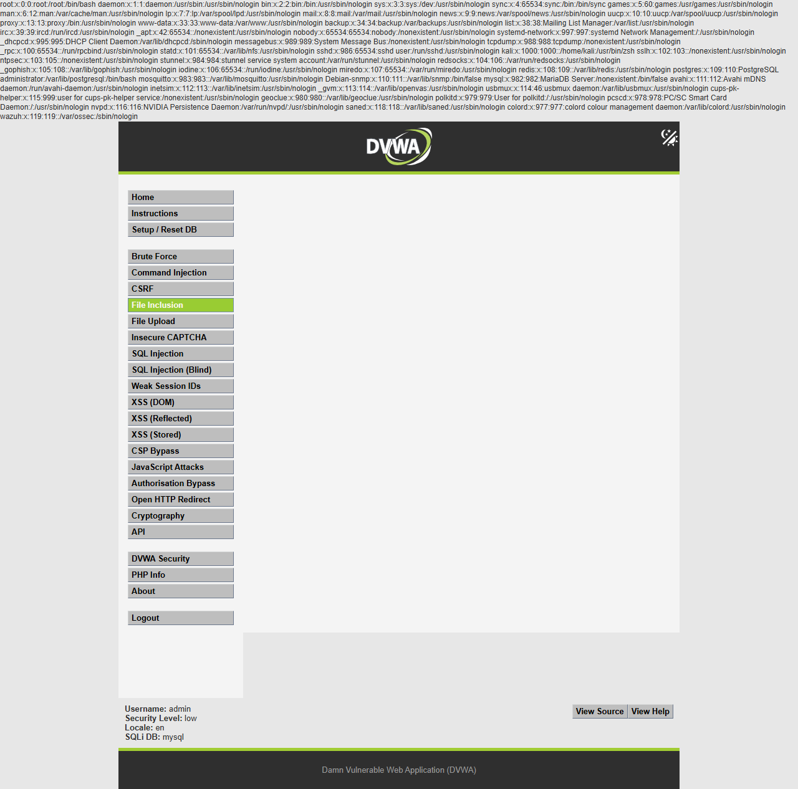
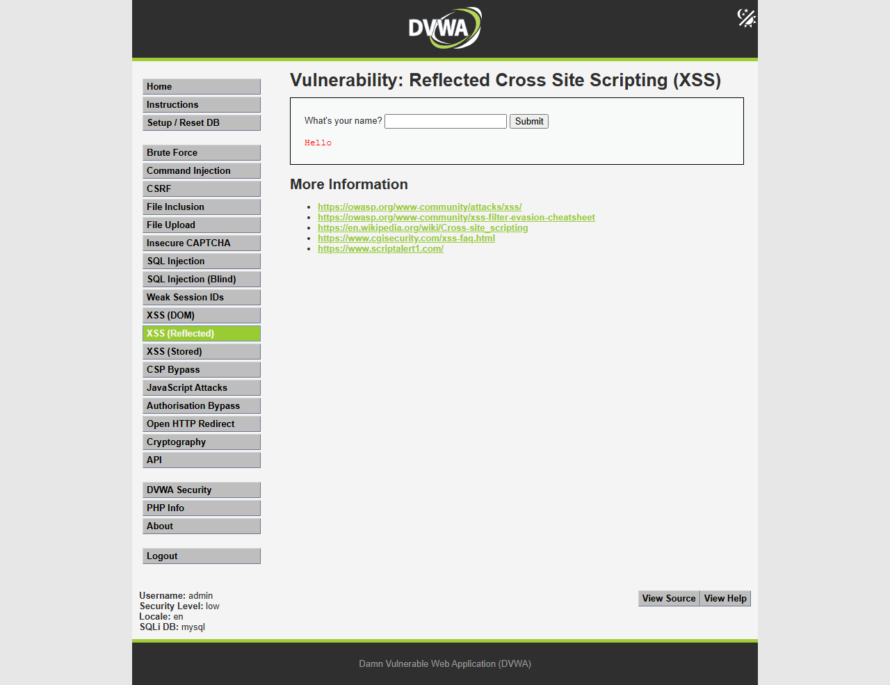
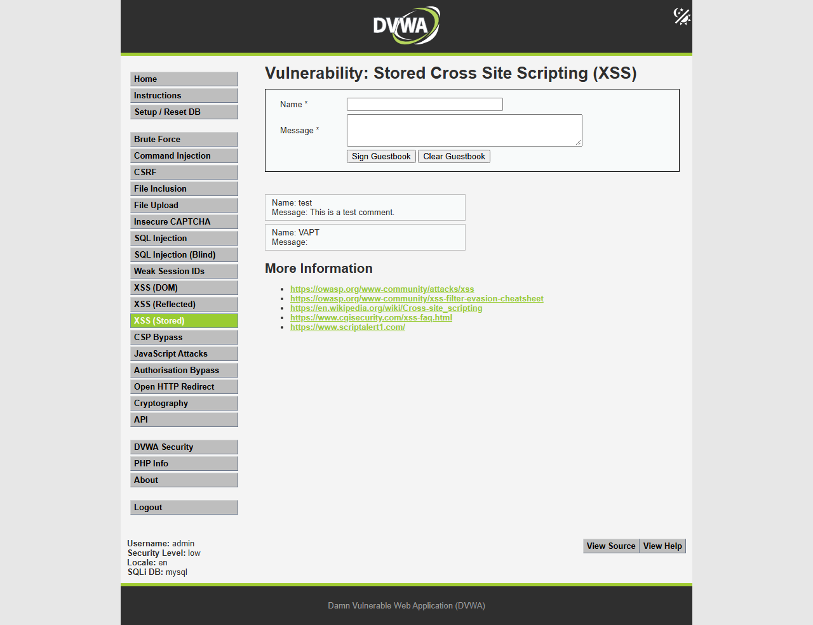

# Vulnerability Assessment & Penetration Testing (VAPT) Report — Human-Edited Final

**Engagement:** DEPI Graduation Program — Project 5 Isolated Lab Assessment  
**Targets:** `LAB.LOCAL` Active Directory Dataset · Live DVWA (`172.24.186.6/dvwa`) · `diva-beta.apk` (`jakhar.aseem.diva`)  
**Lead Analyst:** Mohamed Reda Elhaddad (`@7adadd`)  
**Assessment Date:** 2026-11-26 · **Classification:** Educational — Isolated Self-Owned Lab Only

---

## 1. Executive Summary

An AI-assisted, human-validated Vulnerability Assessment and Penetration Testing (VAPT) engagement was conducted against a controlled three-tier laboratory environment comprising an Active Directory domain graph (`LAB.LOCAL`), a live Damn Vulnerable Web Application (`DVWA` on Kali WSL2 Apache/PHP/MariaDB), and a decompiled Android mobile application (`DIVA`). Across all targets, **9 distinct findings** were confirmed through manual verification and live exploitation: **1 Critical**, **4 High**, and **4 Medium** severity issues.

### Risk Distribution Summary (Verified via `calc_cvss.py`)

| Severity | CVSS v3.1 Range | Count | Finding IDs |
|---|---|---|---|
| **Critical** | 9.0 – 10.0 | **1** | `F-02` (9.8) |
| **High** | 7.0 – 8.9 | **4** | `F-01` (8.8), `F-04` (8.8), `F-05` (8.8), `F-03` (7.1) |
| **Medium** | 4.0 – 6.9 | **4** | `F-06` (6.5), `F-08` (6.2), `F-07` (5.4), `F-09` (5.1) |
| **Low** | 0.1 – 3.9 | **0** | — |
| **Total** | — | **9** | **100% Human-Validated** |

### Top 3 Business Risks
1. **Unauthenticated Domain Takeover via AS-REP Roasting & DCSync (`F-02`, CVSS 9.8 Critical):** An unauthenticated attacker can crack `j.smith`'s AS-REP hash (`DONT_REQ_PREAUTH`), reset `svc-sync`'s password (`ForceChangePassword`), and replicate all domain password hashes via `DCSync`.
2. **Full Database & Server Compromise on Web Tier (`F-04`, `F-05`, CVSS 8.8 High):** Live exploitation of UNION-based SQL Injection (`F-04`) extracted all user MD5 credentials, while OS Command Injection (`F-05`) yielded arbitrary command execution as `www-data`.
3. **Multi-Hop AD ACL Escalation & Cleartext Service Secrets (`F-01`, `F-03`, `F-08`):** Delegated `GenericAll`/`WriteDacl` rights grant `m.ali` a 3-hop path to `Domain Admins`, compounded by a cleartext password in AD (`TempPass2026!`) and hardcoded/logged mobile secrets.

### AI-Assistance & Human-Validation Disclosure (Ethics Rule E7)
In accordance with the project Privacy & Ethics Policy, initial triage, attack-path explanations, payload brainstorming, and draft finding prose were accelerated using **100% locally hosted LLMs** (`qwen2.5:3b` and `llama3.2:3b` via Ollama on `127.0.0.1:11434`). **No lab or test data was sent to any cloud API.** Every finding, payload, line citation, and CVSS v3.1 score in this final report was independently verified by the human analyst (`L1–L4` gates), resulting in the removal of several AI hallucinations present in the raw draft (documented in `week4-hallucination-check-and-diff.md`).

---

## 2. Scope & Methodology

- **Active Directory & Recon (`Week 2`):** Real Kali WSL Nmap XML (`nmap -sV -sC`) + service banner enumeration + BloodHound JSON (`LAB.LOCAL`) solved deterministically via BFS (`scripts/ingest/bloodhound_to_context.py`).
- **Web Application (`Week 3`):** Live DVWA (`low` security level) hosted on Apache 2.4.68 / PHP 8.4.22 / MariaDB 11.8.8; 5 live PoCs executed and screenshotted via Playwright (`scripts/run_dvwa_pocs.py`).
- **Mobile Application (`Week 3`):** `diva-beta.apk` decompiled via `jadx` v1.5.6 (`718` classes); static source & manifest analysis plus static/signature-verified Frida hooks.
- **CVSS v3.1 Verification (`Week 4`):** All Base Scores computed deterministically with `scripts/reporting/calc_cvss.py`.

---

## 3. Summary of Validated Findings

| ID | Title | Domain | CVSS v3.1 Vector | Score | Severity | Validation |
|---|---|---|---|---|---|---|
| `F-01` | Multi-Hop AD Privilege Escalation (`GenericAll` -> `WriteDacl`) | AD | `CVSS:3.1/AV:N/AC:L/PR:L/UI:N/S:U/C:H/I:H/A:H` | **8.8** | **High** | ✅ L1+L3+L4 |
| `F-02` | AS-REP Roasting + `ForceChangePassword` -> `DCSync` | AD | `CVSS:3.1/AV:N/AC:L/PR:N/UI:N/S:U/C:H/I:H/A:H` | **9.8** | **Critical** | ✅ L1+L3+L4 |
| `F-03` | Cleartext Password in AD Description, Weak Policy & R/W Share | AD | `CVSS:3.1/AV:N/AC:L/PR:L/UI:N/S:U/C:H/I:L/A:N` | **7.1** | **High** | ✅ L1+L4 |
| `F-04` | SQL Injection (UNION-Based) in DVWA User Lookup | Web | `CVSS:3.1/AV:N/AC:L/PR:L/UI:N/S:U/C:H/I:H/A:H` | **8.8** | **High** | ✅ L2 (Live PoC) |
| `F-05` | OS Command Injection in DVWA Ping Utility | Web | `CVSS:3.1/AV:N/AC:L/PR:L/UI:N/S:U/C:H/I:H/A:H` | **8.8** | **High** | ✅ L2 (Live PoC) |
| `F-06` | Local File Inclusion (Path Traversal) in DVWA File Inclusion | Web | `CVSS:3.1/AV:N/AC:L/PR:L/UI:N/S:U/C:H/I:N/A:N` | **6.5** | **Medium** | ✅ L2 (Live PoC) |
| `F-07` | Reflected & Stored Cross-Site Scripting (XSS) in DVWA | Web | `CVSS:3.1/AV:N/AC:L/PR:L/UI:R/S:C/C:L/I:L/A:N` | **5.4** | **Medium** | ✅ L2 (Live PoC) |
| `F-08` | Hardcoded Vendor Secret & Cleartext Credit Card Logging | Mobile | `CVSS:3.1/AV:L/AC:L/PR:N/UI:N/S:U/C:H/I:N/A:N` | **6.2** | **Medium** | ✅ L1+L4 |
| `F-09` | Plaintext SharedPreferences, Debuggable Flag & Exported Provider | Mobile | `CVSS:3.1/AV:L/AC:L/PR:N/UI:N/S:U/C:L/I:L/A:N` | **5.1** | **Medium** | ✅ L1+L4 |

---

## 4. Detailed Technical Findings

### F-01: Active Directory Multi-Hop Privilege Escalation via GenericAll and WriteDacl
- **Severity:** **High** — **CVSS 8.8** (`CVSS:3.1/AV:N/AC:L/PR:L/UI:N/S:U/C:H/I:H/A:H`)
- **Affected Asset:** `LAB.LOCAL` (`m.ali@LAB.LOCAL`, `svc-backup@LAB.LOCAL`, `IT-ADMINS@LAB.LOCAL`, `DOMAIN ADMINS@LAB.LOCAL`)
- **Description:** A 3-hop ACL escalation path exists in `LAB.LOCAL`. Low-privileged user `m.ali` holds `GenericAll` over `svc-backup` (which also exposes a Kerberoastable SPN `MSSQLSvc/db01.lab.local:1433`). `svc-backup` is a member of `IT-ADMINS`, which holds `WriteDacl` directly on `DOMAIN ADMINS`.
- **Steps to Reproduce (Verified via BFS & ACL Audit):**
  1. Run `python scripts/ingest/bloodhound_to_context.py lab/ad-lab-dataset/bloodhound_lab.json` to confirm shortest path `[E01] -> [E02] -> [E03]`.
  2. Verify dangerous ACEs in `lab/ad-lab-dataset/acl_dump.txt` lines `[1]` and `[2]` (and via `scripts/generated/ad_acl_audit.ps1`).
  3. Abuse `GenericAll` (targeted Kerberoasting / Shadow Credentials / password reset) on `svc-backup`, inherit `IT-ADMINS` membership, and leverage `WriteDacl` on `DOMAIN ADMINS` to add a controlled account.
- **Impact:** Complete compromise of Domain Admins and full Active Directory domain control.
- **Remediation:** Revoke `GenericAll` for `m.ali` on `svc-backup`, remove `WriteDacl` granted to `IT-ADMINS` on `DOMAIN ADMINS`, and rotate `svc-backup`'s password to a 25+ character random secret (or migrate to gMSA).

---

### F-02: AS-REP Roasting Chained with ForceChangePassword Leading to DCSync
- **Severity:** **Critical** — **CVSS 9.8** (`CVSS:3.1/AV:N/AC:L/PR:N/UI:N/S:U/C:H/I:H/A:H`)
- **Affected Asset:** `LAB.LOCAL` (`j.smith@LAB.LOCAL`, `svc-sync@LAB.LOCAL`, Domain Naming Context `LAB.LOCAL`)
- **Description:** Account `j.smith` is configured with `DONT_REQ_PREAUTH` (AS-REP Roastable without prior credentials). Once `j.smith` is compromised, `j.smith` holds `User-Force-Change-Password` over `svc-sync`, which in turn holds `DS-Replication-Get-Changes-All` and `DS-Replication-Get-Changes` (`DCSync`) on `LAB.LOCAL`.
- **Steps to Reproduce (Verified via BFS & `bh_path_auditor.py`):**
  1. Verify `j.smith` flag `DONT_REQ_PREAUTH` in `lab/ad-lab-dataset/spn_asrep_dump.txt` and `[bh:node j.smith@LAB.LOCAL]`.
  2. Request an AS-REP ticket offline (e.g., `impacket-GetNPUsers LAB.LOCAL/j.smith -no-pass`) and crack offline.
  3. Reset `svc-sync`'s password using `[bh:edge E04]` (`ForceChangePassword`) and execute `impacket-secretsdump` (`[bh:edge E05/E06]` `DCSync`) to extract `krbtgt` and all domain NTLM hashes.
- **Impact:** Unauthenticated attacker can achieve full domain compromise, forge Golden Tickets, and extract every credential in `LAB.LOCAL`.
- **Remediation:** Enable Kerberos Pre-Authentication for `j.smith`, remove `ForceChangePassword` from non-tier-0 accounts over `svc-sync`, and restrict AD replication rights strictly to Domain Controllers.

---

### F-03: Cleartext Password in AD Description, Weak Password Policy & Writable Share
- **Severity:** **High** — **CVSS 7.1** (`CVSS:3.1/AV:N/AC:L/PR:L/UI:N/S:U/C:H/I:L/A:N`)
- **Affected Asset:** `LAB.LOCAL` user `helpdesk01`, Domain Password Policy, `\\DC01\DeptDocs`
- **Description:** `enum4linux_lab.txt` reveals three compounding hygiene weaknesses: (1) user `helpdesk01`'s AD `description` attribute contains the cleartext password `TempPass2026!`, readable by any authenticated domain user; (2) the domain password policy enforces a minimum length of 7 with **zero account lockout threshold (`0`)**; and (3) share `DeptDocs` grants `READ/WRITE` access to `Authenticated Users`.
- **Steps to Reproduce:**
  1. Query LDAP/SMB enumeration output (`lab/ad-lab-dataset/enum4linux_lab.txt` lines 5–7, 18, 28).
  2. Read `helpdesk01` description (`TempPass2026!`) as any low-privileged domain user and authenticate as `helpdesk01`.
- **Impact:** Immediate lateral movement using the leaked credential, unrestricted password-spraying risk, and potential malicious file planting on `DeptDocs`.
- **Remediation:** Clear the `description` attribute and rotate `helpdesk01`'s password immediately; enforce minimum password length >= 12 and account lockout threshold (e.g., 5 attempts / 15 min); restrict `DeptDocs` write permissions to specific security groups.

---

### F-04: SQL Injection (UNION-Based) in DVWA User Lookup
- **Severity:** **High** — **CVSS 8.8** (`CVSS:3.1/AV:N/AC:L/PR:L/UI:N/S:U/C:H/I:H/A:H`)
- **Affected Asset:** `http://172.24.186.6/dvwa/vulnerabilities/sqli/` (GET parameter `id`)
- **Description:** The `id` parameter is concatenated directly into a MariaDB SQL query without parameterization or type casting, permitting arbitrary `UNION SELECT` database extraction.
- **Steps to Reproduce & Live Proof:**
  1. Authenticate to DVWA (`admin:password`, security level `low`).
  2. Submit `id=1' UNION SELECT user,password FROM users-- -` (`evidence/week3/requests/01-sqli-request.txt`).
  3. **Observed Output:** Application dumped all 5 database users and MD5 hashes (`admin`, `gordonb`, `1337`, `pablo`, `smithy`).

- **Impact:** Full read access to backend MariaDB tables, user credential hashes, and potential privilege escalation depending on DB permissions.
- **Remediation:** Replace string concatenation with prepared statements / parameterized queries (`PDO` or `mysqli::prepare`) and enforce strict integer validation on `id`.

---

### F-05: OS Command Injection in DVWA Ping Utility
- **Severity:** **High** — **CVSS 8.8** (`CVSS:3.1/AV:N/AC:L/PR:L/UI:N/S:U/C:H/I:H/A:H`)
- **Affected Asset:** `http://172.24.186.6/dvwa/vulnerabilities/exec/` (POST parameter `ip`)
- **Description:** User-supplied `ip` values are passed directly into an OS shell invocation (`ping`) without sanitization or strict IP format validation, enabling arbitrary shell command chaining.
- **Steps to Reproduce & Live Proof:**
  1. Send POST request with `ip=127.0.0.1; id&Submit=Submit` (`evidence/week3/requests/04-cmdi-request.txt`).
  2. **Observed Output:** Response rendered ping output followed by `uid=33(www-data) gid=33(www-data) groups=33(www-data)`.

- **Impact:** Remote Code Execution (RCE) under the `www-data` web server account, allowing full web-tier compromise and database credential access (`config.inc.php`).
- **Remediation:** Validate `ip` strictly with `filter_var($ip, FILTER_VALIDATE_IP)` and avoid shell execution (`exec` with argument arrays or native PHP sockets instead of `shell_exec`).

---

### F-06: Local File Inclusion (Path Traversal) in DVWA File Inclusion Module
- **Severity:** **Medium** — **CVSS 6.5** (`CVSS:3.1/AV:N/AC:L/PR:L/UI:N/S:U/C:H/I:N/A:N`)
- **Affected Asset:** `http://172.24.186.6/dvwa/vulnerabilities/fi/` (GET parameter `page`)
- **Description:** The `page` parameter is passed directly to PHP `include()` without path canonicalization or an allowlist, allowing directory traversal outside the web root to read arbitrary OS files readable by `www-data`.
- **Steps to Reproduce & Live Proof:**
  1. Request `GET /dvwa/vulnerabilities/fi/?page=../../../../../../etc/passwd` (`evidence/week3/requests/05-lfi-request.txt`).
  2. **Observed Output:** Full `/etc/passwd` contents returned (`root:x:0:0:root:/root:/bin/bash`, `www-data:x:33:33:...`). (Note: password hashes reside in `/etc/shadow`, not `/etc/passwd`.)

- **Impact:** Arbitrary local file disclosure (including application source and configuration files containing database credentials).
- **Remediation:** Enforce a strict static allowlist (`in_array($page, ['include.php', 'file1.php', ...], true)`) and reject any path separators (`/` or `..`).

---

### F-07: Reflected and Stored Cross-Site Scripting (XSS) in DVWA
- **Severity:** **Medium** — **CVSS 5.4** (`CVSS:3.1/AV:N/AC:L/PR:L/UI:R/S:C/C:L/I:L/A:N`)
- **Affected Asset:** `/dvwa/vulnerabilities/xss_r/` (`name`) and `/dvwa/vulnerabilities/xss_s/` (`mtxMessage`)
- **Description:** User input is reflected and stored in HTML responses without context-aware output encoding or a restrictive Content Security Policy (CSP), enabling arbitrary client-side JavaScript execution.
- **Steps to Reproduce & Live Proof:**
  1. Reflected XSS: navigate to `/dvwa/vulnerabilities/xss_r/?name=`.
  2. Stored XSS: submit `mtxMessage=` to `/dvwa/vulnerabilities/xss_s/` and reload.
  3. **Observed Output:** Live Chromium triggered both `XSS-R` and `XSS-S` alert dialogs.

- **Impact:** Session hijacking (where cookies lack `HttpOnly`), forced authenticated actions (CSRF bypass), and persistent malicious script delivery to every visitor of the guestbook.
- **Remediation:** Apply `htmlspecialchars($input, ENT_QUOTES, 'UTF-8')` before rendering in HTML context and deploy a strict `Content-Security-Policy` header (`script-src 'self'`).

---

### F-08: Hardcoded Vendor Secret & Cleartext Credit Card Logging in DIVA APK
- **Severity:** **Medium** — **CVSS 6.2** (`CVSS:3.1/AV:L/AC:L/PR:N/UI:N/S:U/C:H/I:N/A:N`)
- **Affected Asset:** `jakhar.aseem.diva` (`diva-beta.apk` — `HardcodeActivity.java:19`, `LogActivity.java:23`)
- **Description:** Static decompilation via `jadx` revealed two sensitive exposure flaws:
  1. `HardcodeActivity.java:19` embeds a hardcoded plaintext secret (`"vendorsecretkey"`).
  2. `LogActivity.java:23` logs raw user credit card numbers to Android Logcat (`Log.e("diva-log", "Error while processing transaction with credit card: " + cctxt.getText().toString())`).
- **Verification & Tooling:** Verified line-by-line in `evidence/week3/diva-src/sources/jakhar/aseem/diva/`; runtime hook signatures verified via `scripts/generated/frida_diva_hardcode_hook.js`.
- **Impact:** Any user who decompiles the APK retrieves the vendor key; any local app or ADB log reader on older Android versions can harvest plaintext credit card numbers from Logcat.
- **Remediation:** Remove all hardcoded secrets and validate authorization server-side; **completely remove** credit card / PII logging from all `Log.*` levels (do not merely downgrade `Log.e` to `Log.w`).

---

### F-09: Plaintext SharedPreferences, Debuggable Flag & Exported ContentProvider in DIVA APK
- **Severity:** **Medium** — **CVSS 5.1** (`CVSS:3.1/AV:L/AC:L/PR:N/UI:N/S:U/C:L/I:L/A:N`)
- **Affected Asset:** `jakhar.aseem.diva` (`InsecureDataStorage1Activity.java:20-26`, `AndroidManifest.xml:18-19, 76-80`)
- **Description:** `InsecureDataStorage1Activity` writes `"user"` and `"password"` unencrypted to `PreferenceManager.getDefaultSharedPreferences(this)`. Furthermore, `AndroidManifest.xml` sets `android:debuggable="true"` (`line 18`), `android:allowBackup="true"` (`line 19`), and exports `NotesProvider` (`android:exported="true"`, `line 79`) with no `android:permission` restriction, alongside implicit-intent-exported `APICredsActivity` / `APICreds2Activity` (`lines 59–74`).
- **Impact:** Local attackers or malicious co-resident apps can attach debuggers, extract app backups via ADB, read plaintext credentials, and query/modify `NotesProvider`.
- **Remediation:** Use `EncryptedSharedPreferences` backed by Android Keystore; set `android:debuggable="false"` and `android:allowBackup="false"` in release builds; set `android:exported="false"` or require a `signature`-level `android:permission` on `NotesProvider` and API credential activities.

---

## 5. Prioritized Remediation Roadmap

| Horizon | Finding IDs | Action | Expected Risk Reduction | Verification Method |
|---|---|---|---|---|
| **Immediate (0–7 days)** | `F-02`, `F-01`, `F-04`, `F-05` | Remove `DONT_REQ_PREAUTH` & unauthorized `ForceChangePassword`/`DCSync`/`WriteDacl` ACLs; rotate `svc-backup`/`svc-sync`; patch DVWA SQLi (prepared statements) & CMDi (strict IP validation, no shell). | Eliminates Critical domain takeover & High RCE/DB dump | Re-run `bh_path_auditor.py` & re-test DVWA PoCs (`poc-01`, `poc-04`) |
| **Short-Term (30 days)** | `F-03`, `F-06`, `F-07` | Purge `helpdesk01` AD description & enforce password policy (min 12, lockout 5); restrict `DeptDocs` ACLs; enforce LFI allowlist & HTML output encoding + CSP. | Removes lateral movement & file/XSS exposure | Re-run `enum4linux` audit & re-test `poc-02`, `poc-03`, `poc-05` |
| **Strategic (90 days)** | `F-08`, `F-09` | Remove hardcoded secrets & all PII/CC Logcat calls; migrate to `EncryptedSharedPreferences`; harden `AndroidManifest.xml` (`debuggable=false`, `allowBackup=false`, `exported=false`) and integrate SAST/DAST in CI. | Hardens mobile release baseline & prevents regressions | Decompile release APK with `jadx` + re-run `M1`/`M3` audit |
